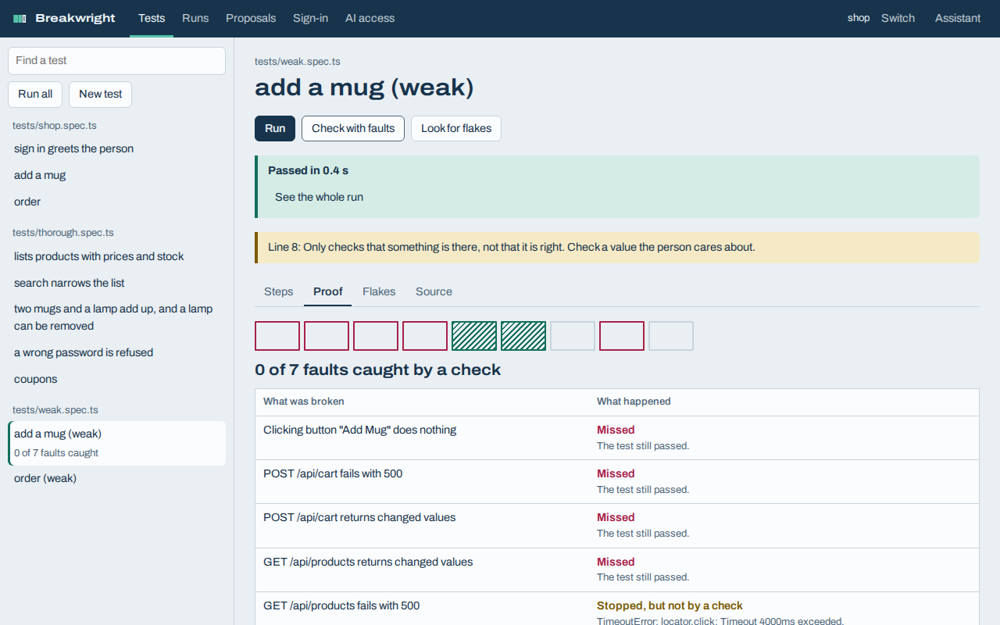

# Breakwright

Know that your browser tests really test something. Breakwright is a local app for Playwright projects. It breaks your app on
purpose, one thing at a time, and shows which breakages your tests miss. Tests stay ordinary files in your folder. No
account, nothing hosted.

- **Tests as steps.** Read and edit a test as steps; code Breakwright doesn't recognise is kept exactly as it is.
- **Fault check.** Failed responses, changed values, empty answers, buttons that do nothing. No test file is changed.
- **Plain failures.** What happened and what to look at.
- **Flake lab.** Repeat a test, then again with slow responses.
- **AI that proposes.** Your own key, a local model, or your AI app over MCP. Changes wait for you, and anything that
  changes what a test proves is flagged.
- **Sign-in helpers.** Saved sign-ins, one-time codes, a local inbox for sign-in mail.

## Start
Needs Node 22.15+ and a project with `@playwright/test` (checked with 1.65; fault check also run with 1.63).

    npm install && npm run build
    node dist/cli.mjs open path/to/project
    node dist/cli.mjs --help

## Understand the results
| Result | Meaning |
|---|---|
| Caught by a check | An assertion failed. This is what you want. |
| Stopped | A step couldn't go on. The test noticed, but no check did. |
| Missed | The test stayed green. |
| Not reached | The fault never took effect, so it proves nothing and isn't counted. |

Some misses are fine: a cart test needn't notice every product price. The score describes one test's strength, not how
much of the app is covered. Requests your tests mock themselves can't be broken. Faults cover fetch/XHR and clicks; not
WebSockets, server rendering or request bodies. Tests must cope with being repeated; if the clean run at the end fails,
the result says it can't be trusted.

On large apps expect 2-3 minutes a test, and some `not reached`: clicks named by generated ids or random data can't be
matched again yet.

## AI over MCP
`claude mcp add breakwright -- node /path/dist/cli.mjs mcp /path/to/project --allow run,propose --site http://localhost:3000`

Without `--allow`, tools only read. Nothing can apply a change. `run-proposals` lets an assistant execute code it wrote:
leave it off unless you mean it.

## Develop
`npm test` (`node scripts/test.mjs core|parts|live` for one), `npm run typecheck`, `node scripts/walk.mjs` (drives the
app and takes pictures), `node scripts/benchmark.mjs`.

## Status
Early, with no release yet. Tests run on Linux, Windows and macOS with Chromium; Firefox and WebKit are untried. CI builds the
desktop app for all three (unsigned); only its first window on Windows has been tried. A small local model (through
Ollama, on the demo shop) has been tried with the assistant; give it more than Ollama's 4096-token context for longer work. Not affiliated with Microsoft or the Playwright project.

## License
MIT. Made by OGCrafts.
